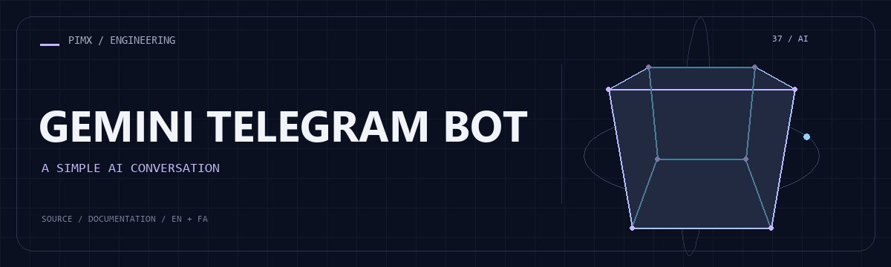

<div align="center">



**[English](README.md) · [فارسی](README.fa.md)**

</div>

# ✨ GEMINI TELEGRAM BOT

A compact Telegram long-polling bot that sends user text to the Gemini REST API and applies a system prompt loaded from a local text file.

[GitHub](https://github.com/MOHAMMADREZAABEDINPOOR/telegram-bot) · [PIMX / Profile](https://github.com/MOHAMMADREZAABEDINPOOR) · [Static artwork](assets/readme/hero.png)

| At a glance | Details |
|:---|:---|
| ✨ Experience | Telegram bot and its supporting tools |
| 🧰 Built with | `requests==2.32.3` |
| 🌐 Documentation | [English](README.md) · [فارسی](README.fa.md) |

[✨ Features](#features) · [🚀 Getting started](#getting-started) · [⚙️ Configuration](#configuration) · [🌍 Deployment](#deployment)

---

<a id="features"></a>

## ✨ Features

| Area | Included capability |
|:---|:---|
| ⚡ Workflow | Telegram getUpdates polling and update offset tracking |
| 🧠 Intelligence | Gemini generateContent requests through requests |
| ⚡ Workflow | Editable UTF-8 system_prompt.txt |
| ⚡ Workflow | Typing status, text replies and error handling |

<a id="stack"></a>

## 🧰 Stack

| Tool | Version / source |
|---|---|
| requests==2.32.3 | `requirements.txt` |

<a id="getting-started"></a>

## 🚀 Getting started

Python 3; a desktop/Tk installation for Tkinter or turtle examples. Tkinter is provided by the Python installation, not pip. Legacy dependencies may need a compatible Python version.

```bash
git clone https://github.com/MOHAMMADREZAABEDINPOOR/telegram-bot.git
cd telegram-bot

python -m venv .venv
# Windows: .venv\Scripts\Activate.ps1; macOS/Linux: source .venv/bin/activate
python -m pip install -r requirements.txt
# PowerShell: $env:TELEGRAM_BOT_TOKEN = "your-token"
# PowerShell: $env:GEMINI_API_KEY = "your-key"
# macOS/Linux: export TELEGRAM_BOT_TOKEN="your-token" GEMINI_API_KEY="your-key"
python bot.py
```

Credentials are read from process environment variables or a local `.env` file. `.env.example` is a template; copy it to `.env` and fill in your own values.

<a id="configuration"></a>

## ⚙️ Configuration

These names are found in the example configuration or source; not all are required. Check their defaults/usage in those files and supply secrets only in your local or hosting environment.

| Name | Role |
|---|---|
| `GEMINI_API_KEY` | Credential/connection setting; keep private |
| `TELEGRAM_BOT_TOKEN` | Credential/connection setting; keep private |

<a id="usage"></a>

## 🎯 Usage

Copy .env.example to .env, set TELEGRAM_BOT_TOKEN and GEMINI_API_KEY, customize system_prompt.txt and run bot.py. Process environment variables take precedence over the local file.

<a id="project-structure"></a>

## 🗂️ Project structure

| Path | Role |
|---|---|
| [`assets/`](assets/) | Brand/media/README assets |
| [`bot.py`](bot.py) | Project entry/configuration file |

<a id="commands-and-checks"></a>

## 🧪 Commands and checks

No automated test command is declared in a manifest. Verify behavior through a local example run.

<a id="deployment"></a>

## 🌍 Deployment

Host a long-running bot process with environment secrets and private storage. Run a single polling instance. Check network access and dependency compatibility on the host.

<a id="limitations"></a>

## 📌 Limitations

Requests are handled sequentially and require network access. The bot does not provide persistent multi-turn memory. If polling conflicts with an existing webhook or another instance, stop that instance/remove the webhook first.

<a id="troubleshooting"></a>

## 🛠️ Troubleshooting

- Authentication/provider errors: verify credentials and selected model/provider.
- No Telegram updates: check polling/webhook mode and concurrent bot instances.
- Missing dependencies: use the declared manifest or inspect imports if no manifest is provided.

<a id="contributing"></a>

## 🤝 Contributing

Create a focused branch, verify the affected behavior and explain the change clearly. Keep private data, build outputs and local databases out of commits.

<a id="license"></a>

## 📄 License

No repository-level license file is included in this snapshot. Public visibility alone does not grant reuse rights; contact the repository owner for terms.

---

Part of **PIMX** · Documentation in English and Persian.

---

<div align="center">

✨ **GEMINI TELEGRAM BOT** · [English](README.md) · [فارسی](README.fa.md)

</div>
